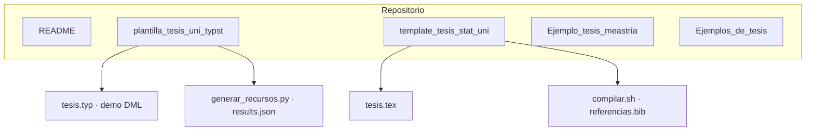

<div align="center">


# Grupo de Estudio de Inferencia Causal

**Universidad Nacional de Ingeniería · FIECS · Perú**

<br>

[](plantilla_tesis_uni_typst/)
[](template_tesis_stat_uni/)
[](plantilla_tesis_uni_typst/generar_recursos.py)
[](https://creativecommons.org/licenses/by/4.0/)

<br>

*Plantillas de tesis para maestría y doctorado, alineadas a la Unidad de Posgrado,*  
*con una mini-tesis demostrativa sobre estimación causal reproducible (DML).*

</div>

---

## Navegación rápida

| Recurso | Qué encontrará |
| :--- | :--- |
| [`plantilla_tesis_uni_typst/`](plantilla_tesis_uni_typst/) | Plantilla **Typst** + demo completa (Chernozhukov et al. 2018, tablas, figuras, `verificar_cifras.py`) |
| [`template_tesis_stat_uni/`](template_tesis_stat_uni/) | Plantilla **LaTeX** modular (biblatex-APA, entornos matemáticos, `latexmk`) |
| [`Ejemplo_tesis_meastria/`](Ejemplo_tesis_meastria/) | Referencias de tesis premiadas (maestría) |
| [`Ejemplos_de_tesis/`](Ejemplos_de_tesis/) | Listado complementario de ejemplos |

---

## Estructura



---

## Objetivos

- **Plantillas** en LaTeX y Typst coherentes con la guía metodológica de la Unidad de Posgrado UNI.
- **Rigor causal**: identificación, estimandos (ATE), citas canónicas y reproducibilidad de cifras.
- **Espacio de estudio** para integrantes y asesorados en estadística aplicada e inferencia causal.

---

## Inicio rápido

<details>
<summary><strong>Typst</strong> — compilar la demo</summary>

```bash
cd plantilla_tesis_uni_typst
./compilar.sh
python3 verificar_cifras.py   # coherencia Tabla 4.2 ↔ results.json
```

Requisitos: [Typst](https://github.com/typst/typst/releases) ≥ 0.15 · Python 3.10+ con `pip install -r requirements.txt` para regenerar figuras.

</details>

<details>
<summary><strong>LaTeX</strong> — compilar la plantilla</summary>

```bash
cd template_tesis_stat_uni
./compilar.sh    # latexmk + biber
```

Requisitos: TeX Live con `latexmk`, `biber` y paquetes estándar de la plantilla.

</details>

---

## Integrantes

| Integrante | Enlace |
| :--- | :---: |
| German Arturo Marcillo Hernandez | [LinkedIn](https://www.linkedin.com/) |
| Randy Fernandez Palomino | [LinkedIn](https://www.linkedin.com/in/randy-fern%C3%A1ndez-palomino-913426179/) |
| Antonio Lan | [LinkedIn](https://www.linkedin.com/) |
| Angela Morales | [LinkedIn](https://www.linkedin.com/) |
| Juan Carlos | [LinkedIn](https://www.linkedin.com/) |

> Si falta su perfil, abra un issue o PR con el enlace correcto.

---

<div align="center">

<sub>Grupo de Estudio de Inferencia Causal · UNI Perú · 2026</sub>

</div>
