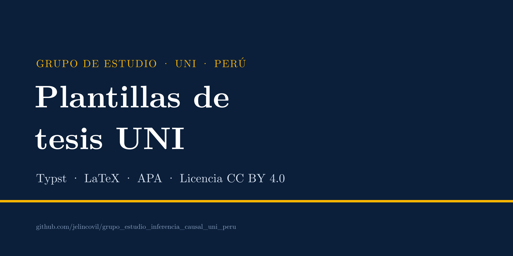
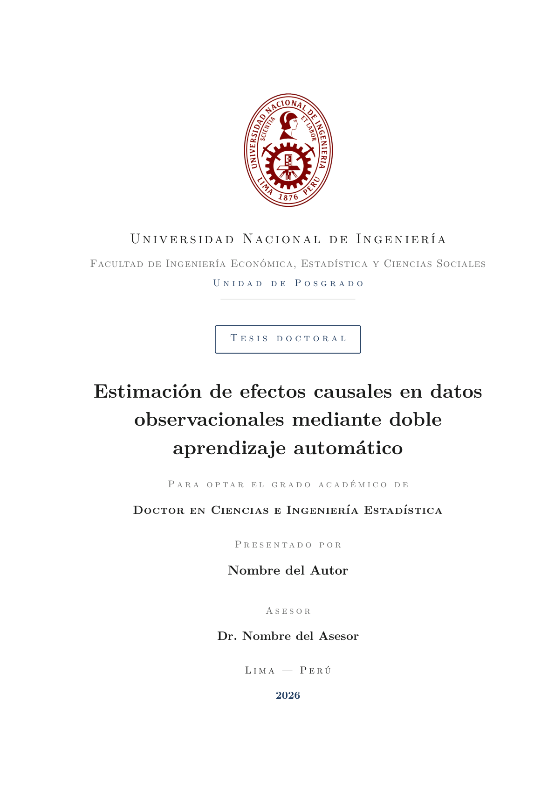
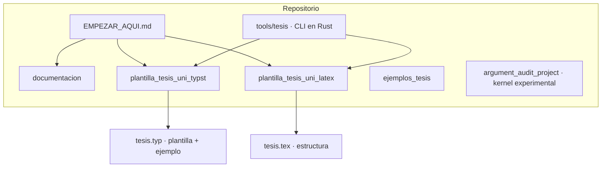

<div align="center">



# Plantillas de tesis UNI · Typst y LaTeX

**Escribe tu tesis en Typst o LaTeX sin pelear con el formato. Plantillas, guías, PDF de ejemplo compilado y un CLI para empezar — todo gratis y con licencia CC BY 4.0.**

<sub>Universidad Nacional de Ingeniería · FIEECS · Perú · mantenido por el Grupo de Estudio de Inferencia Causal</sub>

<br>

[](https://github.com/jelincovil/grupo_estudio_inferencia_causal_uni_peru/actions/workflows/ci.yml)
[](https://github.com/jelincovil/grupo_estudio_inferencia_causal_uni_peru/releases)
[](https://creativecommons.org/licenses/by/4.0/)
[](https://github.com/jelincovil/grupo_estudio_inferencia_causal_uni_peru/pulls)
[](https://github.com/jelincovil/grupo_estudio_inferencia_causal_uni_peru/discussions)

</div>

## Demostración

Vista previa de la portada del PDF de ejemplo (Typst). El archivo completo está en el repositorio y en el [release de demostración](https://github.com/jelincovil/grupo_estudio_inferencia_causal_uni_peru/releases/tag/v0.1.0-demo).

<p align="center">
  <a href="plantilla_tesis_uni_typst/tesis.pdf">
    
  </a>
</p>

---

## Inicio rápido

**Tres pasos** (detalle en [`EMPEZAR_AQUI.md`](EMPEZAR_AQUI.md)):

```bash
git clone https://github.com/jelincovil/grupo_estudio_inferencia_causal_uni_peru.git
cd grupo_estudio_inferencia_causal_uni_peru/plantilla_tesis_uni_typst
./compilar.sh
```

**Typst en local** (plantilla recomendada; el PDF de ejemplo ya está en el repo):

```bash
cd plantilla_tesis_uni_typst && ./compilar.sh
```

**LaTeX en local** (`latexmk` + `biber` + `texlive-lang-spanish`):

```bash
cd plantilla_tesis_uni_latex && ./compilar.sh
```

**Sin instalar Typst:** suba la carpeta [`plantilla_tesis_uni_typst/`](plantilla_tesis_uni_typst/) a [typst.app](https://typst.app) y abra `tesis.typ` en el editor web (cuenta gratuita).

**Con el CLI `tesis`** (Rust; scaffold + chequeo de placeholders):

```bash
cargo install --path tools/tesis
tesis new mi-tesis --plantilla typst --autor "Nombre Apellido"
tesis check mi-tesis
```

---

## ¿Typst o LaTeX?

| Criterio | Typst (recomendado) | LaTeX |
| :--- | :--- | :--- |
| Instalación | Un binario (`typst`) | TeX Live completo (varios GB) |
| Compilación | Incremental, casi instantánea | Más lenta (el ejemplo corre en CI con `latexmk`) |
| Sintaxis | Moderna, cercana a markdown | Clásica; curva de aprendizaje empinada |
| Ejemplo completo compilado | ✅ `tesis.pdf` (tesis DML) | Andamiaje estructural (cuerpo con `\lipsum`) |
| Ecuaciones y bibliografía APA | ✅ | ✅ (`biblatex`-`biber`) |
| Ideal para | Quien empieza desde cero | Quien ya domina TeX o su facultad lo exige |

Detalle en [`documentacion/05-equivalencias-latex-typst.md`](documentacion/05-equivalencias-latex-typst.md).

---

## ¿Qué incluye?

| Pieza | Para qué sirve | Empieza aquí |
| :--- | :--- | :--- |
| [`plantilla_tesis_uni_typst/`](plantilla_tesis_uni_typst/) | Plantilla **Typst** con estructura UNI, APA y un **PDF de ejemplo** (`tesis.pdf`) de una tesis DML real | [`README`](plantilla_tesis_uni_typst/README.md) · [`./compilar.sh`](plantilla_tesis_uni_typst/compilar.sh) |
| [`plantilla_tesis_uni_latex/`](plantilla_tesis_uni_latex/) | Plantilla **LaTeX** (estructura UNI con `latexmk` + `biber`) | [`README`](plantilla_tesis_uni_latex/README.md) · [`./compilar.sh`](plantilla_tesis_uni_latex/compilar.sh) |
| [`documentacion/`](documentacion/) | Criterios de redacción: capítulos, estilo, tablas, fórmulas, referencias, equivalencias LaTeX↔Typst, enlaces a normativa UNI | [`README`](documentacion/README.md) |
| [`ejemplos_tesis/`](ejemplos_tesis/) | Fichas de tesis ajenas **con enlace comprobado** (maestría y doctorado) | [`README`](ejemplos_tesis/README.md) |
| [`tools/tesis/`](tools/tesis/) | **CLI `tesis`** en Rust: `tesis new` crea un proyecto personalizado; `tesis check` detecta placeholders sin sustituir | [`README`](tools/tesis/README.md) |
| [`argument_audit_project/`](argument_audit_project/) | **argument-audit** *(experimental)* — workspace Rust: kernel de alegatos tipados (claims, dependencias, evidencia) con verificador determinista; 99 tests; sin llamadas a modelos | [`README`](argument_audit_project/README.md) |

---

## `argument-audit` — kernel experimental de auditoría de alegatos

Nuevo componente (en desarrollo activo): un workspace Rust con un **kernel administrativo para alegatos tipados** — claims, dependencias y registros de evidencia — y un verificador determinista. No ejecuta código externo, no llama modelos y **nunca promueve `claim_supported`**. Incluye render/parse de tarjetas (`argument-card`) y un CLI (`argument-audit`) con `check`, `align`, `explain` y emisión de grafos de contexto.

- **Estado:** experimental (`publish = false`); fases F0–F8 pendientes en [`argument_audit_project/progress/STATE.json`](argument_audit_project/progress/STATE.json). No es un certificado de lectura de ningún corpus.
- **Verificado:** `cargo test --workspace` → 99 passing; `cargo clippy --workspace --all-targets -- -D warnings` → limpio.
- **Detalle:** [`argument_audit_project/README.md`](argument_audit_project/README.md).

## Estructura



| Archivo o carpeta | Propósito |
| :--- | :--- |
| [`EMPEZAR_AQUI.md`](EMPEZAR_AQUI.md) | Ruta del tesista (normativa, plantilla, guías) |
| [`reproduce.sh`](reproduce.sh) | Verificación local alineada al CI |
| [`plantilla_tesis_uni_typst/tesis.typ`](plantilla_tesis_uni_typst/tesis.typ) | Fuente Typst (plantilla + documento de ejemplo) |
| [`plantilla_tesis_uni_typst/tesis.pdf`](plantilla_tesis_uni_typst/tesis.pdf) | PDF de ejemplo versionado |
| [`.github/workflows/ci.yml`](.github/workflows/ci.yml) | Compila Typst y LaTeX (y prueba el CLI) en cada push/PR |
| [`ejemplos_tesis/`](ejemplos_tesis/) | Listado curado de tesis con enlaces verificados |

---

## Preguntas frecuentes

**¿Sirve fuera de la UNI?** La estructura y la normativa son UNI; las guías de redacción y ambas plantillas son adaptables a cualquier universidad (cambie el bloque `meta` de `tesis.typ` o los `\newcommand` de `tesis.tex`).

**¿Puedo usar el ejemplo DML como mi tesis?** No. Es una tesis de demostración con datos simulados. Reemplace capítulos, cifras y referencias por los suyos.

**¿Por dónde empiezo si nunca he escrito una tesis?** [`EMPEZAR_AQUI.md`](EMPEZAR_AQUI.md), luego compile la plantilla y modifique una sección a la vez.

**¿Cómo reporto un error de compilación?** Abra un issue con la plantilla [«Error de compilación»](https://github.com/jelincovil/grupo_estudio_inferencia_causal_uni_peru/issues/new?template=bug-compilacion.yml) e incluya versión de Typst/TeX Live, comando y log.

**¿Quiere preguntar algo o proponer una mejora?** Use [Discussions](https://github.com/jelincovil/grupo_estudio_inferencia_causal_uni_peru/discussions) — es el lugar para dudas y propuestas antes de abrir un PR.

**¿Puedo redistribuir o adaptar el material?** Sí, con atribución: licencia [CC BY 4.0](https://creativecommons.org/licenses/by/4.0/). Vea [`LICENSE`](LICENSE) y [`CITATION.cff`](CITATION.cff) si lo usa en un trabajo académico.

---

## Comunidad

- **Preguntas / ideas:** [GitHub Discussions](https://github.com/jelincovil/grupo_estudio_inferencia_causal_uni_peru/discussions)
- **Errores:** [issues con plantilla «Error de compilación»](https://github.com/jelincovil/grupo_estudio_inferencia_causal_uni_peru/issues/new?template=bug-compilacion.yml) · [proponer cambios](https://github.com/jelincovil/grupo_estudio_inferencia_causal_uni_peru/issues/new/choose)
- **Contribuir:** [`CONTRIBUTING.md`](CONTRIBUTING.md) · [código de conducta](CODE_OF_CONDUCT.md) · [seguridad](SECURITY.md)
- El repo está indexado en [awesome-typst](https://github.com/qjcg/awesome-typst/pull/279) y el [release `v0.1.0-demo`](https://github.com/jelincovil/grupo_estudio_inferencia_causal_uni_peru/releases/tag/v0.1.0-demo) adjunta el PDF de ejemplo.

## Integrantes del grupo

| Integrante | Enlace |
| :--- | :---: |
| German Arturo Marcillo Hernandez | — |
| Randy Fernandez Palomino | [LinkedIn](https://www.linkedin.com/in/randy-fern%C3%A1ndez-palomino-913426179/) |
| Antonio Lan | — |
| Angela Morales | — |
| Juan Carlos | — |

> Si falta su perfil, abra un issue o PR con el enlace correcto.

## Cómo crece este proyecto

Cada tesista que clona el repo, lo adapta, compila su tesis y manda un PR mejora el siguiente que llega. Da tu estrella si te fue útil — alimenta la visibilidad del proyecto.

[](https://star-history.com/#jelincovil/grupo_estudio_inferencia_causal_uni_peru&Date)

---

## Licencia

© 2026 Grupo de Estudio de Inferencia Causal — UNI (Universidad Nacional de Ingeniería, Perú).

Contenido del repositorio bajo [Creative Commons Atribución 4.0 Internacional (CC BY 4.0)](https://creativecommons.org/licenses/by/4.0/), salvo normativa institucional o obras de terceros citadas en las plantillas. El texto legal íntegro está en [`LICENSE`](LICENSE).

<div align="center">

<sub>Herramientas para tesistas · UNI · Perú · 2026</sub>

</div>
