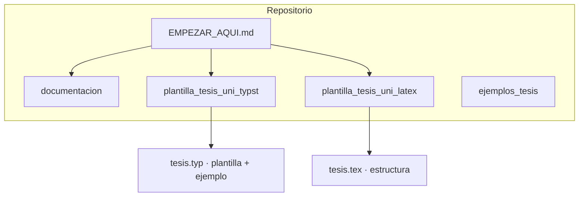

<div align="center">


# Grupo de Estudio de Inferencia Causal

**Universidad Nacional de Ingeniería · FIEECS · Perú**

<br>

[](plantilla_tesis_uni_typst/)
[](plantilla_tesis_uni_latex/)
[](documentacion/)
[](https://creativecommons.org/licenses/by/4.0/)

<br>

*Herramientas para tesistas de la UNI (maestría y doctorado):*  
*plantillas de redacción, guías de formato y referencias de tesis verificadas.*

<br>

[](EMPEZAR_AQUI.md)

</div>

---

## Qué hay en este repositorio

No es un curso ni un paquete de métodos: es un **kit de trabajo** para quien escribe su tesis en la Facultad.

| Pieza | Para qué sirve |
| :--- | :--- |
| [`plantilla_tesis_uni_typst/`](plantilla_tesis_uni_typst/) | Plantilla **Typst** con estructura UNI, APA y un **PDF de ejemplo** (`tesis.pdf`) que muestra cómo se ve un documento terminado |
| [`plantilla_tesis_uni_latex/`](plantilla_tesis_uni_latex/) | Plantilla **LaTeX** (andamio estructural; compila con `latexmk` + `biber`) |
| [`documentacion/`](documentacion/) | Criterios de redacción: modelo de capítulos, estilo, tablas, fórmulas, referencias, equivalencias LaTeX↔Typst, enlaces a normativa UNI |
| [`ejemplos_tesis/`](ejemplos_tesis/) | Fichas de tesis ajenas **con enlace comprobado** (maestría y doctorado) |

El grupo de estudio mantiene el material; cualquier tesista de la UNI puede clonarlo y adaptarlo a su tema.

**Si empieza hoy:** [`EMPEZAR_AQUI.md`](EMPEZAR_AQUI.md).

---

## Estructura



---

## Compilar las plantillas

<details>
<summary><strong>Typst</strong></summary>

```bash
cd plantilla_tesis_uni_typst
./compilar.sh
```

Requisito: [Typst](https://github.com/typst/typst/releases) ≥ 0.15.  
El PDF de ejemplo (`tesis.pdf`) ya está en el repositorio; recompile solo si editó `tesis.typ`.

Si regenera figuras del ejemplo: Python 3.10+ y `pip install -r requirements.txt` (ver README de esa carpeta).

</details>

<details>
<summary><strong>LaTeX</strong></summary>

```bash
cd plantilla_tesis_uni_latex
./compilar.sh
```

Requisitos: TeX Live con `latexmk`, `biber`, `texlive-lang-spanish`.

</details>

<details>
<summary><strong>Verificación automática</strong> (mantenimiento del repo)</summary>

```bash
./reproduce.sh
```

Ejecuta coherencia de cifras del ejemplo Typst y compilación en CI. No es obligatorio para redactar su propia tesis.

</details>

---

## Integrantes del grupo

| Integrante | Enlace |
| :--- | :---: |
| German Arturo Marcillo Hernandez | [LinkedIn](https://www.linkedin.com/) |
| Randy Fernandez Palomino | [LinkedIn](https://www.linkedin.com/in/randy-fern%C3%A1ndez-palomino-913426179/) |
| Antonio Lan | [LinkedIn](https://www.linkedin.com/) |
| Angela Morales | [LinkedIn](https://www.linkedin.com/) |
| Juan Carlos | [LinkedIn](https://www.linkedin.com/) |

> Si falta su perfil, abra un issue o PR con el enlace correcto.

---

<div align="center">

<sub>Herramientas para tesistas · UNI · Perú · 2026</sub>

</div>
