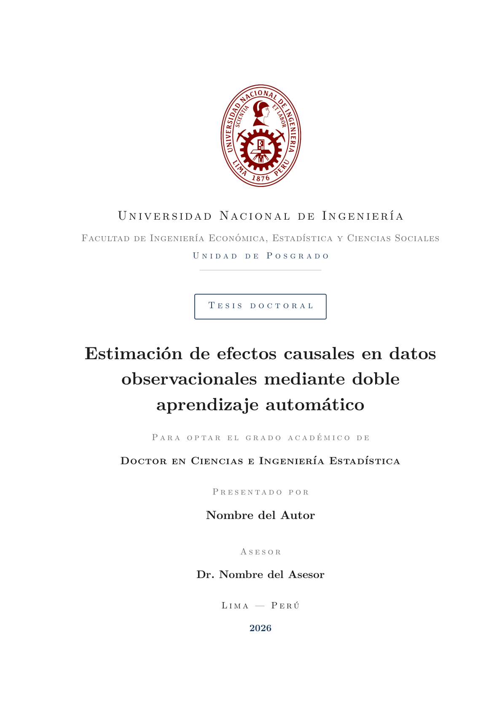
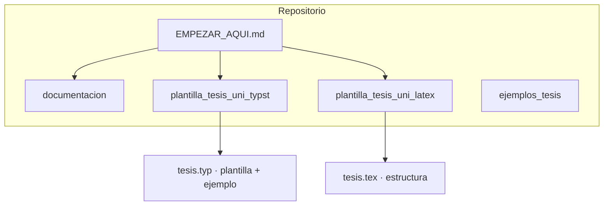

<div align="center">


# Plantillas de tesis UNI · Typst y LaTeX

**Escribe tu tesis en Typst o LaTeX sin pelear con el formato. Plantillas, guías y PDF de ejemplo listos para compilar.**

<sub>Universidad Nacional de Ingeniería · FIEECS · Perú · mantenido por el Grupo de Estudio de Inferencia Causal</sub>

<br>

[](plantilla_tesis_uni_typst/)
[](plantilla_tesis_uni_latex/)
[](documentacion/)
[](https://creativecommons.org/licenses/by/4.0/)
[](https://github.com/jelincovil/grupo_estudio_inferencia_causal_uni_peru/actions/workflows/ci.yml)
[](https://github.com/jelincovil/grupo_estudio_inferencia_causal_uni_peru/pulls)

</div>

## Demostración

Vista previa de la portada del PDF de ejemplo (Typst). El archivo completo está en el repositorio y en el [release de demostración](https://github.com/jelincovil/grupo_estudio_inferencia_causal_uni_peru/releases/tag/v0.1.0-demo).

<p align="center">
  <a href="plantilla_tesis_uni_typst/tesis.pdf">
    
  </a>
</p>

---

## ¿Qué incluye?

No es un curso ni un paquete de métodos: es un **kit de trabajo** para quien escribe su tesis en la Facultad. El grupo de estudio mantiene el material; cualquier tesista de la UNI puede clonarlo y adaptarlo a su tema.

| Pieza | Para qué sirve | Empieza aquí |
| :--- | :--- | :--- |
| [`plantilla_tesis_uni_typst/`](plantilla_tesis_uni_typst/) | Plantilla **Typst** con estructura UNI, APA y un **PDF de ejemplo** (`tesis.pdf`) que muestra cómo se ve un documento terminado | [`README`](plantilla_tesis_uni_typst/README.md) · [`./compilar.sh`](plantilla_tesis_uni_typst/compilar.sh) |
| [`plantilla_tesis_uni_latex/`](plantilla_tesis_uni_latex/) | Plantilla **LaTeX** (andamio estructural; compila con `latexmk` + `biber`) | [`README`](plantilla_tesis_uni_latex/README.md) · [`./compilar.sh`](plantilla_tesis_uni_latex/compilar.sh) |
| [`documentacion/`](documentacion/) | Criterios de redacción: modelo de capítulos, estilo, tablas, fórmulas, referencias, equivalencias LaTeX↔Typst, enlaces a normativa UNI | [`README`](documentacion/README.md) |
| [`ejemplos_tesis/`](ejemplos_tesis/) | Fichas de tesis ajenas **con enlace comprobado** (maestría y doctorado) | [`README`](ejemplos_tesis/README.md) |

---

## Inicio rápido

**Tres pasos** (detalle en [`EMPEZAR_AQUI.md`](EMPEZAR_AQUI.md)):

```bash
git clone https://github.com/jelincovil/grupo_estudio_inferencia_causal_uni_peru.git
cd grupo_estudio_inferencia_causal_uni_peru/plantilla_tesis_uni_typst
./compilar.sh
```

**Typst en local** (plantilla recomendada si quiere ver el PDF de ejemplo):

```bash
cd plantilla_tesis_uni_typst && ./compilar.sh
```

**LaTeX en local:**

```bash
cd plantilla_tesis_uni_latex && ./compilar.sh
```

**Sin instalar Typst:** suba la carpeta `plantilla_tesis_uni_typst/` a [typst.app](https://typst.app) y abra `tesis.typ` en el editor web (requiere cuenta gratuita).

Guía paso a paso completa: [`EMPEZAR_AQUI.md`](EMPEZAR_AQUI.md).

---

## Estructura



| Archivo o carpeta | Propósito |
| :--- | :--- |
| [`EMPEZAR_AQUI.md`](EMPEZAR_AQUI.md) | Ruta del tesista (normativa, plantilla, guías) |
| [`reproduce.sh`](reproduce.sh) | Verificación local alineada al CI |
| [`plantilla_tesis_uni_typst/tesis.typ`](plantilla_tesis_uni_typst/tesis.typ) | Fuente Typst (plantilla + documento de ejemplo) |
| [`plantilla_tesis_uni_typst/tesis.pdf`](plantilla_tesis_uni_typst/tesis.pdf) | PDF de ejemplo versionado |
| [`plantilla_tesis_uni_latex/tesis.tex`](plantilla_tesis_uni_latex/tesis.tex) | Fuente LaTeX (estructura UNI) |
| [`.github/workflows/ci.yml`](.github/workflows/ci.yml) | Compila Typst y LaTeX en cada push/PR |
| [`ejemplos_tesis/`](ejemplos_tesis/) | Listado curado de tesis con enlaces verificados |

---

## Requisitos

**Typst** ([releases](https://github.com/typst/typst/releases) ≥ **0.15**):

```bash
cd plantilla_tesis_uni_typst
./compilar.sh
```

El PDF de ejemplo (`tesis.pdf`) ya está en el repositorio; recompile solo si editó `tesis.typ`.

**LaTeX** (TeX Live con **`latexmk`**, **`biber`**, **`texlive-lang-spanish`**):

```bash
cd plantilla_tesis_uni_latex
./compilar.sh
```

**Regenerar figuras del ejemplo Typst** (opcional): Python **3.10+** y `pip install -r plantilla_tesis_uni_typst/requirements.txt` (ver README de esa carpeta).

---

## Verificación automática

```bash
./reproduce.sh
```

Ejecuta coherencia de cifras del ejemplo Typst (`verificar_cifras.py`) y compilación cuando tenga Typst y, opcionalmente, `latexmk` instalados. El mismo flujo corre en CI (`.github/workflows/ci.yml`: jobs **typst-y-python** y **latex**). **No es obligatorio** para redactar su propia tesis; sirve para mantenimiento del repositorio.

---

## Integrantes del grupo

| Integrante | Enlace |
| :--- | :---: |
| German Arturo Marcillo Hernandez | [LinkedIn](https://www.linkedin.com/) |
| Randy Fernandez Palomino | [LinkedIn](https://www.linkedin.com/in/randy-fern%C3%A1ndez-palomino-913426179/) |
| Antonio Lan | [LinkedIn](https://www.linkedin.com/) |
| Angela Morales | [LinkedIn](https://www.linkedin.com/) |
| Juan Carlos | [LinkedIn](https://www.linkedin.com/) |

> Si falta su perfil, abra un issue o PR con el enlace correcto.

---

## Licencia

Contenido del repositorio bajo [Creative Commons Atribución 4.0 Internacional (CC BY 4.0)](https://creativecommons.org/licenses/by/4.0/), salvo normativa institucional o obras de terceros citadas en las plantillas.

<div align="center">

<sub>Herramientas para tesistas · UNI · Perú · 2026</sub>

</div>
