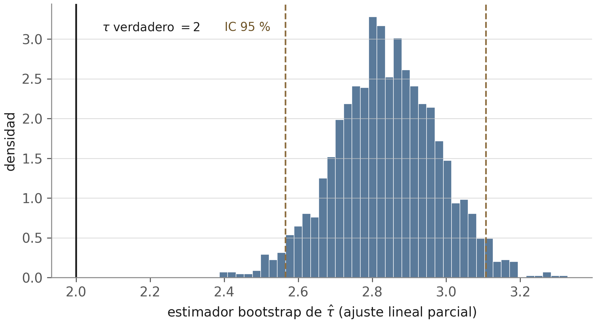
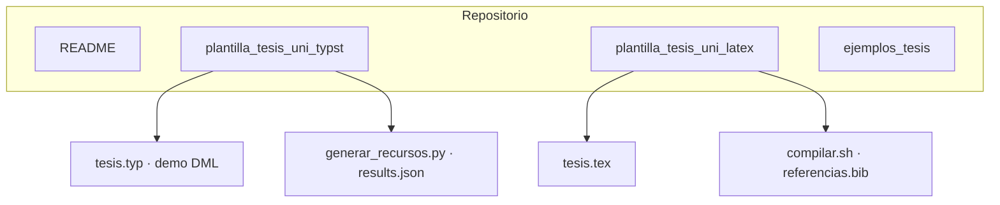

<div align="center">


# Grupo de Estudio de Inferencia Causal

**Universidad Nacional de Ingeniería · FIEECS · Perú**

<br>

[](plantilla_tesis_uni_typst/)
[](plantilla_tesis_uni_latex/)
[](plantilla_tesis_uni_typst/generar_recursos.py)
[](https://creativecommons.org/licenses/by/4.0/)

<br>

*Plantillas de tesis para maestría y doctorado, alineadas a la Unidad de Posgrado,*  
*con una mini-tesis demostrativa sobre estimación causal reproducible (DML).*

<br>

[](EMPEZAR_AQUI.md)
[](plantilla_tesis_uni_typst/tesis.pdf)

</div>

---

## Lo que enseña la mini-tesis

El grupo elaboró una demo reproducible para que quien llegue al seminario vea, con cifras verificables, una distinción que costó años entender en muchos currículos: **precisión no es causalidad**. Con **τ = 2** y **n = 5 000**, el OLS mal especificado sigue con sesgo ≈ **+0,95** y **0 %** de cobertura al 95 %: el error estándar encoge; la conclusión errónea no.

<p align="center">
  
  <br>
  <sub><em>El remuestreo mide variabilidad, no corrección.</em></sub>
</p>

```bash
python3 leccion_60s.py              # resume las cifras en terminal (sin NumPy)
python3 leccion_60s.py --compartir  # una línea para citar el demo
```

La misma idea en HTML: [`docs/la_leccion.html`](docs/la_leccion.html). Si desea publicarla, active **GitHub Pages** (*Settings → Pages → GitHub Actions*).

Si va a escribir su tesis, empiece por [`EMPEZAR_AQUI.md`](EMPEZAR_AQUI.md).

---

## Navegación rápida

| Recurso | Qué encontrará |
| :--- | :--- |
| [`EMPEZAR_AQUI.md`](EMPEZAR_AQUI.md) | Ruta del tesista + lección de 60 s |
| [`docs/la_leccion.html`](docs/la_leccion.html) | Resumen visual de la demo (bootstrap y cobertura) |
| [`documentacion/`](documentacion/) | Guías 00–06: modelo de tesis, editorial, visual, fórmulas, referencias, LaTeX↔Typst, enlaces UNI |
| [`plantilla_tesis_uni_typst/`](plantilla_tesis_uni_typst/) | Plantilla **Typst** + demo completa (Chernozhukov et al. 2018, tablas, figuras, `verificar_cifras.py`) |
| [`plantilla_tesis_uni_latex/`](plantilla_tesis_uni_latex/) | Plantilla **LaTeX** modular (biblatex-APA, entornos matemáticos, `latexmk`) |
| [`ejemplos_tesis/`](ejemplos_tesis/) | Tesis de referencia verificadas (maestría y doctorado, un solo listado) |

---

## Estructura



---

## Objetivos

- **Plantillas** en LaTeX y Typst coherentes con la guía metodológica de la Unidad de Posgrado UNI.
- **Rigor causal**: identificación, estimandos (ATE), citas canónicas y reproducibilidad de cifras.
- **Espacio de estudio** para integrantes y asesorados en estadística aplicada e inferencia causal.

---

## Inicio rápido

<details>
<summary><strong>Typst</strong> — compilar la demo</summary>

```bash
./reproduce.sh                # verificar cifras + compilar Typst (y LaTeX si hay latexmk)
cd plantilla_tesis_uni_typst
./compilar.sh
```

Requisitos: [Typst](https://github.com/typst/typst/releases) ≥ 0.15 · Python 3.10+ con `pip install -r requirements.txt` para regenerar figuras.

</details>

<details>
<summary><strong>LaTeX</strong> — compilar la plantilla</summary>

```bash
cd plantilla_tesis_uni_latex
./compilar.sh    # latexmk + biber
```

Requisitos: TeX Live con `latexmk`, `biber` y paquetes estándar de la plantilla.

</details>

---

## Integrantes

| Integrante | Enlace |
| :--- | :---: |
| German Arturo Marcillo Hernandez | [LinkedIn](https://www.linkedin.com/) |
| Randy Fernandez Palomino | [LinkedIn](https://www.linkedin.com/in/randy-fern%C3%A1ndez-palomino-913426179/) |
| Antonio Lan | [LinkedIn](https://www.linkedin.com/) |
| Angela Morales | [LinkedIn](https://www.linkedin.com/) |
| Juan Carlos | [LinkedIn](https://www.linkedin.com/) |

> Si falta su perfil, abra un issue o PR con el enlace correcto.

---

<div align="center">

<sub>Grupo de Estudio de Inferencia Causal · UNI Perú · 2026</sub>

</div>
